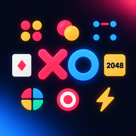

<div align="center">



# KOLO ARCADE — ألعاب كولو

**ألعاب سريعة تعمل بلا إنترنت. العب وحدك أو مع أصدقائك على جهاز واحد.**

*Fast games that work offline. Play solo or with friends on one device.*

`الإصدار 2.0` · `Version 2.0` · `PWA` · `عربي / English` · `بلا إعلانات` · `Made in Sudan`

</div>

---

[العربية](#العربية) · [English](#english)

---

<a id="العربية"></a>
<div dir="rtl">

## العربية

### نبذة
**ألعاب كولو** مجموعة من عشر ألعاب خفيفة في ملف HTML واحد، تعمل على الهاتف والحاسوب دون إنترنت بعد أول فتح. لا حسابات ولا إعلانات ولا تتبّع، وبياناتك تبقى على جهازك فقط.

### الألعاب

| اللعبة | الوصف | الأنماط |
|---|---|---|
| إكس أو | ثلاث في صف | ضد الحاسوب / لاعبان، تلميح، تراجع، وضع الرحمة |
| أربعة في صف | أسقط الأقراص واربط أربعة | ضد الحاسوب / لاعبان، تلميح، تراجع |
| ريفيرسي | اقلب أقراص خصمك واحتل الرقعة | ضد الحاسوب / لاعبان |
| النقاط والمربعات | أغلق المربعات واكسب دورًا إضافيًا | ضد الحاسوب / لاعبان |
| لعبة الذاكرة | اعثر على الأزواج بأقل حركات | فردي |
| كاسح الألغام | افتح الخانات وتجنّب الألغام | فردي |
| 2048 | ادمج الأرقام حتى 2048 | فردي (سحب أو أسهم) |
| سيمون | كرّر تسلسل الأنغام | فردي |
| اضرب الهدف | اختبر سرعة ردّ فعلك | فردي |
| مبارزة الأصابع | الأسرع في الضغط يفوز، أول من يصل إلى 5 | جهاز واحد لاثنين |

### المميزات
- **تعمل دون إنترنت:** عبر Service Worker، وقابلة للتثبيت كتطبيق.
- **اللعب مع الأصدقاء:** وضع اللاعبين على جهاز واحد بالتناوب، ومبارزة الأصابع بوجهين متقابلين.
- **ذكاء بخمسة مستويات:** سهل، متوسط، صعب، تلقائي (يتكيّف مع سلسلة انتصاراتك)، ومتعلّم.
- **الذكاء المتعلّم** (إكس أو وأربعة في صف): يتعرّف على أسلوبك ويكيّف لعبه، ويمكنك مسح ما تعلّمه في أي وقت.
- **نظام تقدّم:** خبرة XP ومستويات، ومهمة يومية، وأيام متتالية، وإنجازات.
- **مظاهر ألوان:** كلاسيك، نيون، ذهبي، نعناع (تُفتح بالمستويات).
- **ثنائية اللغة:** عربي (RTL) وإنجليزي، بتبديل فوري.
- **أصوات مولّدة داخليًا** دون ملفات صوت خارجية.
- **سريعة الاستجابة:** تناسب شاشات الهاتف وتحترم تقليل الحركة في إعدادات الجهاز.

### التشغيل
**الأسهل:** افتح `index.html` مباشرة في المتصفح.

**للتثبيت كتطبيق** يلزم تقديمها عبر `https` أو `localhost`:
```bash
cd kolo-arcade
python -m http.server 8080
# ثم افتح http://localhost:8080
```
وبعدها من قائمة المتصفح اختر **إضافة إلى الشاشة الرئيسية**.

### النشر على GitHub Pages
1. ارفع الملفات إلى مستودع عام.
2. **Settings ← Pages ← Deploy from a branch ← main ← / (root) ← Save**.
3. يعمل الموقع على `https://USERNAME.github.io/REPO/`.

**عند تحديث الملفات** غيّر رقم الذاكرة في `sw.js` (مثل `kolo-v3` إلى `kolo-v4`) كي يحمّل المتصفح النسخة الجديدة.

### إنشاء ملف APK
أبسط طريقة مجانية: [PWABuilder](https://www.pwabuilder.com)، الصق رابط موقعك ثم **Package for stores ← Android**. احتفظ بملف التوقيع `signing.keystore` وكلمة سره في مكان آمن، فهو لازم لتحديث التطبيق لاحقًا.

### هيكل المشروع
```
├── index.html            التطبيق كاملًا (واجهة + ألعاب + ذكاء)
├── sw.js                 Service Worker للعمل دون إنترنت
├── manifest.webmanifest  بيانات التثبيت
├── icon-192.png
└── icon-512.png
```

### الخصوصية والبيانات
تُحفظ الإعدادات والنتائج وتعلّم الذكاء في `localStorage` على جهازك فقط، ولا يُرسل شيء إلى أي خادم. مسح بيانات المتصفح يمسحها.

### حدود معروفة
- لا يوجد لعب بين جهازين عبر الشبكة، فالتناوب على جهاز واحد فقط.
- الذكاء المتعلّم يتاح في إكس أو وأربعة في صف فقط.
- مهمة اليوم تُحسب بتاريخ الجهاز.

### حول المشروع
> لا مؤسسة وراء هذا العمل ولا فريق؛ يدان اثنتان وسهر ليالٍ. إن وجدتَ فيه خيرًا فأعِده إلى صاحبه، وإن وجدتَ خللًا فدلّني عليه، فما زلتُ أتعلّم.

**تطوير وتعديل:** ڪولو سآن (Red X)
*اللهم بارك له في علمه ووقته، واجعل عمله خالصًا لوجهك الكريم.*

### الإبلاغ عن مشكلة
افتح **Issues** في المستودع واذكر: نوع الجهاز والمتصفح، واللعبة، وخطوات تكرار المشكلة، ولقطة شاشة إن أمكن. كل ملاحظة موضع شكر.

</div>

---

<a id="english"></a>

## English

### About
**Kolo Arcade** is a collection of ten lightweight games in a single HTML file. It runs on phones and desktops and works offline after the first load. No accounts, no ads, no tracking: your data never leaves your device.

### Games

| Game | Description | Modes |
|---|---|---|
| Tic-Tac-Toe | Three in a row | Vs computer / two players, hint, undo, mercy mode |
| Connect Four | Drop discs, link four | Vs computer / two players, hint, undo |
| Reversi | Flip your rival's discs and own the board | Vs computer / two players |
| Dots & Boxes | Close boxes and earn extra turns | Vs computer / two players |
| Memory | Match pairs in few moves | Solo |
| Minesweeper | Open cells, avoid the mines | Solo |
| 2048 | Merge tiles up to 2048 | Solo (swipe or arrow keys) |
| Simon | Repeat the tone sequence | Solo |
| Aim Trainer | Test your reaction speed | Solo |
| Finger Duel | Fastest tap wins, first to 5 | One device, two players |

### Features
- **Offline-first** via a Service Worker, installable as an app.
- **Play with friends** on one device by taking turns; Finger Duel is built for two players facing each other.
- **Five AI levels:** Easy, Medium, Hard, Auto (adapts to your win streak), and Learner.
- **Learning AI** (Tic-Tac-Toe, Connect Four): adapts to your play style; you can reset what it learned any time.
- **Progression:** XP and levels, a daily mission, day streaks, achievements.
- **Color themes:** Classic, Neon, Gold, Mint (unlocked by level).
- **Bilingual:** Arabic (RTL) and English with instant switching.
- **Procedurally generated sounds**, no external audio files.
- **Responsive**, mobile-first, and respects reduced-motion settings.

### Run
**Simplest:** open `index.html` directly in a browser.

**To install as an app**, serve it over `https` or `localhost`:
```bash
cd kolo-arcade
python -m http.server 8080
# then open http://localhost:8080
```
Then use the browser menu: **Add to Home Screen**.

### Deploy on GitHub Pages
1. Push the files to a public repository.
2. **Settings → Pages → Deploy from a branch → main → / (root) → Save**.
3. Your site is live at `https://USERNAME.github.io/REPO/`.

**When you update the files**, bump the cache name in `sw.js` (e.g. `kolo-v3` to `kolo-v4`) so browsers fetch the new version.

### Build an APK
The simplest free route is [PWABuilder](https://www.pwabuilder.com): paste your site URL, then **Package for stores → Android**. Keep `signing.keystore` and its password safe; you need it to publish updates later.

### Project structure
```
├── index.html            the whole app (UI + games + AI)
├── sw.js                 Service Worker for offline use
├── manifest.webmanifest  install metadata
├── icon-192.png
└── icon-512.png
```

### Privacy & data
Settings, scores and AI learning are stored in `localStorage` on your device only. Nothing is sent to any server. Clearing browser data erases them.

### Known limits
- No networked play between two devices; friends take turns on one device.
- The learning AI exists only in Tic-Tac-Toe and Connect Four.
- The daily mission uses the device's date.

### About the project
> No company stands behind this work and no team: just two hands and sleepless nights. If you find good in it, return it to its owner; if you find a flaw, point it out to me, for I am still learning.

**Developed & modified by:** ڪولو سآن (Red X)
*May Allah bless his knowledge and time, and make his work sincere.*

### Reporting issues
Open an **Issue** and include: device and browser, the game, steps to reproduce, and a screenshot if possible. Every report is appreciated.

---

<div align="center">

صنع في السودان · Made in Sudan · © 2026

</div>
